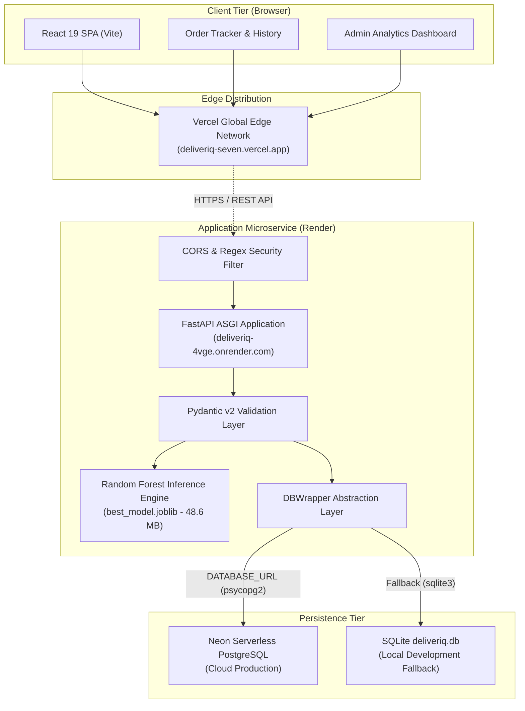

# DeliverIQ — Intelligent Food Delivery Time Prediction & Order Management System

[](https://deliveriq-seven.vercel.app)
[](https://deliveriq-4vge.onrender.com/api/health)
[](https://deliveriq-4vge.onrender.com/docs)
[](https://neon.tech)
[](https://opensource.org/licenses/MIT)

> **Final-Year Academic Capstone Project**<br/>
> *A decoupled, production-grade web application combining machine learning regression, serverless cloud databases, and modern reactive frontends to solve dynamic estimated time of arrival (ETA) challenges in on-demand food delivery logistics.*

---

## 1. Executive Summary & Problem Statement

### 1.1 The Challenge
In modern on-demand food delivery platforms (such as Zomato, Swiggy, Uber Eats, and DoorDash), accurate Estimated Time of Arrival (ETA) calculation is critical. Inaccurate estimates lead to customer dissatisfaction, order cancellations, courier idle time, and cold food delivery.

Delivery duration is governed by complex, multi-factor stochastic variables:
- **Spatial factors:** Haversine distance between restaurant and customer drop location.
- **Environmental factors:** Weather conditions (Sunny, Foggy, Stormy, Cloudy) and road traffic congestion levels (Low, Medium, High, Jam).
- **Logistical factors:** Restaurant kitchen preparation duration, courier age, courier ratings, vehicle type, vehicle mechanical condition, and concurrent active deliveries.
- **Temporal factors:** Peak vs. off-peak pickup hours, day-of-week patterns, weekends, and regional festival events.

Traditional rule-based heuristic formulas (e.g., `distance / average_speed + fixed_prep_time`) fail to capture nonlinear correlations and multi-variable interactions.

### 1.2 The DeliverIQ Solution
**DeliverIQ** addresses this problem by developing, validating, and deploying an end-to-end Machine Learning regression pipeline integrated into a full-stack e-commerce web platform:
1. **Machine Learning Engine:** Evaluates multiple algorithms across 41,944 cleaned historical deliveries, selecting an optimized **Random Forest Regressor** achieving an **MAE of 3.15 minutes** and an **$R^2$ of 0.823**.
2. **High-Performance Microservice:** Exposes the trained pipeline through asynchronous **FastAPI** endpoints for sub-50ms inference.
3. **Decoupled Modern Frontend:** A reactive **React 19 + Vite** single-page application featuring dynamic menu browsing, coupon redemption, simulated checkout, and real-time order tracking.
4. **Resilient Persistence:** A dual-mode database abstraction supporting local **SQLite** for development and serverless **Neon PostgreSQL** for production.
5. **Operational Analytics:** An administrative dashboard providing operational key performance indicators (KPIs), order status progression, and revenue metrics.

> **Academic Disclaimer:** All restaurant menus, coupons, and customer transactions within DeliverIQ are strictly simulated for academic demonstration and research. No real currency is charged and no commercial logistics are dispatched.

---

## 2. Live Deployments & Repository Links

| Resource | Description | URL |
|---|---|---|
| **Production Frontend** | React 19 SPA deployed on Vercel Edge Network | [https://deliveriq-seven.vercel.app](https://deliveriq-seven.vercel.app) |
| **Production Backend** | FastAPI ML Microservice on Render Web Service | [https://deliveriq-4vge.onrender.com](https://deliveriq-4vge.onrender.com) |
| **Interactive API Docs** | OpenAPI / Swagger UI interactive specification | [https://deliveriq-4vge.onrender.com/docs](https://deliveriq-4vge.onrender.com/docs) |
| **System Health Check** | Live JSON probe verifying database & ML runtime | [https://deliveriq-4vge.onrender.com/api/health](https://deliveriq-4vge.onrender.com/api/health) |
| **GitHub Repository** | Source code, models, pipelines, and tests | [https://github.com/arpitaghetiya/DeliverIQ](https://github.com/arpitaghetiya/DeliverIQ) |

---

## 3. Technology Stack

```
Frontend (Vercel)          Backend (Render)              Database (Neon)
[React 19 + Vite]  ───▶  [FastAPI + Uvicorn]  ───▶  [Serverless PostgreSQL]
         │                       │
         └──────── (CORS) ───────┴───▶ [Random Forest Engine (48.6 MB)]
```

### Frontend Architecture
- **Framework & Runtime:** React 19 (Hooks, Context API, Suspense)
- **Tooling & Build System:** Vite 6 with Hot Module Replacement (HMR)
- **Styling & UI:** Tailwind CSS, responsive mobile-first grid, Lucide React icons
- **State & Routing:** Native React state management and client-side page routing
- **Deployment Platform:** Vercel Hobby Edge Global CDN

### Backend Microservice
- **Language & Framework:** Python 3.11+, FastAPI (high-concurrency asynchronous ASGI)
- **Server:** Uvicorn ASGI Web Server
- **Data Validation & Schemas:** Pydantic v2
- **Deployment Platform:** Render Web Service (Free Tier, Linux x86_64 container)

### Machine Learning & Data Science
- **Core Library:** Scikit-learn (Random Forest, Gradient Boosting, Decision Tree, Linear Regression, K-Means)
- **Data Manipulation:** Pandas, NumPy
- **Feature Engineering:** Haversine spatial calculation, ColumnTransformer, StandardScaler, OneHotEncoder
- **Model Serialization:** Joblib (`models/best_model.joblib`, 48.6 MB production bundle)
- **Exploratory Studio (Legacy/Research):** Streamlit (`app.py`), Matplotlib, Seaborn

### Database & Persistence
- **Production Engine:** Neon Serverless PostgreSQL (managed, SSL `require`, connection pooling via `psycopg2-binary`)
- **Development Engine:** SQLite (`deliveriq.db`) with automatic schema migration
- **Abstraction Layer:** Custom `DBWrapper` in `api.py` providing unified parameter normalization (`?` vs. `%s`), transaction management, and dictionary cursors

---

## 4. System Architecture



---

## 5. Application Features & Workflows

### 5.1 Customer Workflow
1. **Restaurant Discovery:** Explore a curated collection of partner restaurants (e.g., Spice Garden, Burger Hub, Pizza Roma, Sweet Treats) with cuisine tags, ratings, and baseline delivery ranges.
2. **Cart & Dynamic Pricing:** Add individual food items, adjust item quantities, compute itemized subtotal, calculate tiered delivery fees, dynamic taxation, and apply promotional coupons (e.g., `WELCOME50` for ₹50 off, `TASTY20` for 20% discount).
3. **Real-Time ML ETA Prediction:** During checkout, the frontend automatically queries `/api/predict` with current environmental conditions (distance, traffic density, weather, time of day) to display an instant, scientifically estimated delivery time.
4. **Simulated Checkout:** Submit customer contact information (name, phone, delivery address, city type) and choose a simulated payment channel (Cash on Delivery or Simulated UPI/Card).
5. **Instant Order Tracking:** Upon confirmation, an 8-character unique alphanumeric order ID is assigned (e.g., `D155C44E`). Customers monitor their live order state across visual stages:
   $$\text{Confirmed} \longrightarrow \text{Preparing} \longrightarrow \text{Picked Up} \longrightarrow \text{On the Way} \longrightarrow \text{Delivered}$$
6. **My Orders History:** Review all past orders, inspected line items, order amounts, applied coupons, and timestamps stored persistently.

### 5.2 Administrative & Analytics Workflow
1. **Key Performance Indicators (KPIs):** Instant summary of platform metrics:
   - Total Order Count
   - Total Platform Gross Revenue (₹)
   - Average Order Value (AOV)
   - Active Database Engine (`postgresql` in production, `sqlite` locally)
2. **Order Lifecycle Control:** Store managers inspect incoming orders and update delivery milestones via interactive status controls triggering authenticated `PATCH /api/orders/{id}/status` mutations.
3. **Status Distribution Metrics:** Breakdown of orders grouped by operational lifecycle stage.
4. **Restaurant Sales Analytics:** Order distribution and volume per partner merchant.

---

## 6. Dataset & Preprocessing Pipeline

### 6.1 Dataset Specifications
- **Raw Data Source:** `data/Zomato_Dataset.csv` containing **45,584 records** and **20 features**.
- **Cleaned Data Target:** `data/cleaned_data.csv` containing **41,944 records** after validation.
- **Target Variable:** `Time_taken (min)` — continuous integer range between 10 and 54 minutes (sample mean: 26.3 minutes).

### 6.2 Data Cleaning & Integrity Rectifications
1. **Coordinate Sign Correction:** Rectified 431 negative latitude and 162 negative longitude values caused by entry sign errors.
2. **Spatial Boundary Validation:** Filtered out 3,640 records with invalid coordinates (values near 0,0 or outside the geographic boundary of India).
3. **Biological & Rating Bounds:** Identified 46 ratings exceeding 5.0 and 35 courier ages below 18 years; treated anomalies as missing values.
4. **Timestamp Parsing:** Standardized heterogeneous time notations across mixed formats (`HH:MM`, `24:05:00`, Excel fractional floats like `0.8333`).

### 6.3 Feature Engineering
- **Geodesic Haversine Distance (`distance_km`):** Calculated from restaurant GPS $(\phi_1, \lambda_1)$ to customer delivery GPS $(\phi_2, \lambda_2)$:
  $$d = 2R \arcsin\left(\sqrt{\sin^2\left(\frac{\Delta\phi}{2}\right) + \cos\phi_1\cos\phi_2\sin^2\left(\frac{\Delta\lambda}{2}\right)}\right)$$
  *(where $R = 6371\text{ km}$)*
- **Order Preparation Time (`prep_time_min`):** Calculated as the duration between order placement and courier pickup timestamp.
- **Temporal Indicators:** Extracted `pickup_hour` (0–23), `day_of_week` (0–6), and `is_weekend` binary flag.

### 6.4 Data Leakage Prevention & Pipeline Encapsulation
To ensure strict statistical isolation, all data transformations are encapsulated inside a scikit-learn `Pipeline` and `ColumnTransformer`:
- An 80/20 train-test split (`random_state=42`) is performed **before** any fitting.
- Continuous numerical variables are imputed via **median** values and scaled with `StandardScaler`.
- Categorical variables are imputed via **most frequent** values and transformed with `OneHotEncoder(handle_unknown='ignore')`.
- All identifying fields (`ID`, `Delivery_person_ID`, raw dates, and unprojected GPS coordinates) are completely dropped from the feature matrix to eliminate target leakage.

---

## 7. Machine Learning Model Evaluation & Benchmark Results

Four regression algorithms were evaluated using 5-fold cross-validation and tested against the 20% held-out test split (8,389 records, `random_state=42`).

### 7.1 Quantitative Performance Comparison

| Model | MAE (min) | MSE | RMSE (min) | $R^2$ Score | Selection Status |
|---|---|---|---|---|---|
| **Random Forest Regressor** | **3.15** | **15.64** | **3.95** | **0.823** | **Selected for Production** |
| Gradient Boosting Regressor | 3.33 | 17.31 | 4.16 | 0.804 | Baseline Candidate |
| Decision Tree Regressor | 3.76 | 22.73 | 4.77 | 0.742 | Interpretable Baseline |
| Linear Regression | 4.84 | 37.03 | 6.09 | 0.580 | Parametric Baseline |

*Hyperparameter summary for selected model:* 100 estimators, minimum samples split of 5, maximum features `sqrt`, full ensemble parallelized across CPU cores.

### 7.2 Exploratory Data Analysis (EDA) Insights
- **Road Traffic Density:** Average delivery duration escalates sharply with congestion: Low traffic averages 21.3 min, Medium averages 26.7 min, High averages 27.2 min, and Traffic Jam averages 31.2 min.
- **Weather Impacts:** Clear/Sunny weather yields the fastest deliveries (mean 21.9 min), whereas Foggy, Sandstorms, and Cloudy conditions elevate mean duration to ~29.0 min.
- **Concurrent Courier Deliveries:** A single courier carrying 0 multiple packages averages 22.9 min, whereas couriers assigned 3 simultaneous orders average 47.9 min (+109% increase).
- **Festival Periods:** Orders placed during festival periods average 45.5 min versus 26.0 min during normal operations.
- **Courier Ratings & Distance:** Courier rating exhibits a significant negative correlation with delivery time ($-0.34$), while Haversine distance exhibits positive correlation ($+0.32$).

### 7.3 Unsupervised Clustering (K-Means)
Unsupervised clustering on standard logistical coordinates revealed optimal grouping at $k=2$ (silhouette score $= 0.25$):
- **Cluster 0 ("Short & Rapid"):** Average distance $\approx 8.2\text{ km}$, low multiple orders ($0.6$), average duration $21.8\text{ min}$.
- **Cluster 1 ("Long & High-Load"):** Average distance $\approx 13.5\text{ km}$, higher concurrent loads ($1.1$), average duration $36.8\text{ min}$.

---

## 8. REST API Documentation

The production backend provides an OpenAPI 3.0 specification available interactively at `/docs`.

### 8.1 Endpoint Summary

| Method | Endpoint | Description | Auth / Access |
|---|---|---|---|
| `GET` | `/api/health` | Health probe reporting database type and service status | Public |
| `POST` | `/api/predict` | Predict delivery time using Random Forest model | Public |
| `POST` | `/api/orders` | Place a new customer order | Public |
| `GET` | `/api/orders` | Retrieve list of all orders (newest first) | Public |
| `GET` | `/api/orders/{order_id}` | Retrieve single order details and item array | Public |
| `PATCH` | `/api/orders/{order_id}/status` | Update order lifecycle status | Admin |
| `GET` | `/api/admin/stats` | Aggregated analytics, revenue, and status counts | Admin |

### 8.2 Sample Payloads & Responses

#### `POST /api/predict`
**Request Payload:**
```json
{
  "distance_km": 10.0,
  "prep_time_min": 10.0,
  "weather": "Sunny",
  "traffic": "Jam",
  "city_type": "Urban",
  "vehicle": "motorcycle",
  "festival": "No",
  "order_type": "Meal",
  "pickup_hour": 20,
  "day_of_week": 4,
  "is_weekend": 0
}
```

**Response (200 OK):**
```json
{
  "predicted_minutes": 24.5,
  "model": "Random Forest",
  "inputs_used": {
    "Delivery_person_Age": 29,
    "Delivery_person_Ratings": 4.5,
    "distance_km": 10.0,
    "Vehicle_condition": 1,
    "multiple_deliveries": 0,
    "prep_time_min": 10.0,
    "pickup_hour": 20,
    "day_of_week": 4,
    "is_weekend": 0,
    "Weather_conditions": "Sunny",
    "Road_traffic_density": "Jam",
    "Type_of_order": "Meal",
    "Type_of_vehicle": "motorcycle",
    "Festival": "No",
    "City": "Urban"
  }
}
```

#### `GET /api/admin/stats`
**Response (200 OK):**
```json
{
  "total_orders": 1,
  "total_revenue": 290.0,
  "status_counts": {
    "preparing": 1
  },
  "restaurant_counts": {
    "Spice Garden": 1
  },
  "avg_order_value": 290.0,
  "database": "postgresql"
}
```

---

## 9. Local Installation & Development Setup

DeliverIQ supports zero-configuration local execution using SQLite, or connection to remote PostgreSQL via environment variables.

### 9.1 Prerequisites
- Python 3.10, 3.11, or 3.12
- Node.js 18.0+ and npm 9.0+
- Git

### 9.2 Clone & Environment Initialization
```bash
# Clone the repository
git clone https://github.com/arpitaghetiya/DeliverIQ.git
cd DeliverIQ\DeliverIQ

# Create and activate Python virtual environment
python -m venv venv

# Windows (Command Prompt / PowerShell):
venv\Scripts\activate
# Linux / macOS:
source venv/bin/activate

# Install backend dependencies
pip install -r requirements.txt

# Install frontend dependencies
cd frontend
npm install
cd ..
```

### 9.3 Launching Applications

#### Option A: One-Click Startup (Windows)
Using Windows Command Prompt:
```cmd
start.bat
```
Or using PowerShell:
```powershell
Set-ExecutionPolicy -Scope Process -ExecutionPolicy Bypass
.\start.ps1
```
This automatically boots:
- FastAPI ML backend on `http://localhost:8000`
- React Vite frontend on `http://localhost:5173`
- Interactive Swagger docs on `http://localhost:8000/docs`

#### Option B: Manual Execution
In Terminal 1 (FastAPI Backend):
```bash
venv\Scripts\uvicorn.exe api:app --reload --port 8000
```
In Terminal 2 (React Frontend):
```bash
cd frontend
npm run dev
```

#### Option C: Exploratory Streamlit Studio (Data Science Inspection)
To launch the original interactive data exploration and model inspection dashboard:
```bash
venv\Scripts\streamlit.exe run app.py
```
Available at `http://localhost:8501`.

---

## 10. Production Cloud Deployment Configuration

DeliverIQ is engineered for a **100% Free Tier Cloud Architecture** with zero monthly operational expense:

```
┌─────────────────────────────────┐
│       Vercel (Hobby Free)       │  ──▶ React 19 Frontend SPA
└─────────────────────────────────┘
                 │
                 ▼ (Encrypted HTTPS REST Calls)
┌─────────────────────────────────┐
│       Render (Free Tier)        │  ──▶ FastAPI ML Engine (Random Forest)
└─────────────────────────────────┘
                 │
                 ▼ (SSL Connection Pool)
┌─────────────────────────────────┐
│     Neon (Serverless Free)      │  ──▶ Managed PostgreSQL Database
└─────────────────────────────────┘
```

### 10.1 Frontend Configuration (Vercel)
- **Repository Root:** `frontend`
- **Framework Preset:** `Vite`
- **Build Command:** `npm run build`
- **Output Directory:** `dist`
- **Environment Variable:**
  - `VITE_API_URL` = `https://deliveriq-4vge.onrender.com`
- **SPA Rewrites (`frontend/vercel.json`):**
  ```json
  {
    "rewrites": [
      { "source": "/(.*)", "destination": "/index.html" }
    ]
  }
  ```

### 10.2 Backend Configuration (Render)
- **Service Type:** Web Service (Free Linux Instance)
- **Environment:** Python 3
- **Build Command:** `pip install -r requirements-prod.txt`
- **Start Command:** `uvicorn api:app --host 0.0.0.0 --port $PORT`
- **Environment Variables:**
  - `PYTHON_VERSION` = `3.11.9`
  - `DATABASE_URL` = `postgresql://<user>:<password>@<neon-host>/deliveriq?sslmode=require`

### 10.3 Database Configuration (Neon PostgreSQL)
- **Instance Type:** Serverless PostgreSQL 16
- **Storage:** 0.5 GiB free persistent storage
- **Auto-Initialization:** Handled by `init_db()` in `api.py` on container startup, automatically creating table structures, indexes, and constraints if not present.

---

## 11. Live Smoke Testing & End-to-End Verification

A comprehensive audit was executed across the live deployed infrastructure to certify production readiness:

### 11.1 Live Smoke Test Results

| Test Case | Method & Endpoint | Payload / Parameters | Result | Details |
|---|---|---|---|---|
| **API Health Probe** | `GET /api/health` | None | **PASS** | Status `ok`, service `DeliverIQ API`, database engine confirmed as `postgresql`. |
| **Model Inference** | `POST /api/predict` | 10 km, sunny, traffic jam, pickup hr 20 | **PASS** | Returned 24.5 min prediction via active Random Forest model. |
| **Admin Analytics** | `GET /api/admin/stats` | None | **PASS** | Validated database query execution and aggregation on Neon PostgreSQL. |
| **CORS Policy** | `OPTIONS /api/predict` | `Origin: https://deliveriq-seven.vercel.app` | **PASS** | Received `200 OK` with allowed origin headers. |

### 11.2 Controlled End-to-End Customer Transaction Test

A controlled end-to-end transaction was executed against the live Vercel frontend:
- **Order ID:** `D155C44E`
- **Customer Identity:** Aarav Sharma (`demo.aarav@example.com`, `+91 98765 43210`) *(Fictional Demo Identity)*
- **Delivery Address:** 104, Sunrise Residency, SG Highway, Ahmedabad, Gujarat - 380054
- **Restaurant Selected:** Spice Garden (Restaurant ID `1`)
- **Item Purchased:** Chicken Dum Biryani (₹300.00)
- **Coupon Applied:** `WELCOME50` (-₹50.00 discount)
- **Delivery Fee:** ₹40.00 | **Total Paid:** ₹290.00 (Simulated Cash on Delivery)
- **ML Predicted ETA:** 27 minutes
- **Lifecycle Progression:** Transitioned from `confirmed` $\rightarrow$ `preparing` via authenticated status update.
- **Persistence Verification:** Successfully queried and verified within Neon PostgreSQL, displayed in customer "My Orders", and dynamically reflected in the Admin Analytics Dashboard.

---

## 12. Academic Limitations & Future Scope

### 12.1 Limitations
1. **Semi-Synthetic Artifacts in Historical Dataset:** The public Zomato dataset exhibits certain counter-intuitive patterns (e.g., "Semi-Urban" deliveries record longer average durations than dense "Urban" locations, likely reflecting regional infrastructure differences or sample distribution).
2. **Cold-Start Latency on Free Cloud Tier:** Render free-tier containers automatically spin down after 15 minutes of inactivity; the initial request after dormancy may experience a 30–50 second cold-start delay while spinning up.
3. **Simulated Commerce:** Payment gateways, SMS OTP delivery, and courier mobile GPS telematics are simulated for demonstration purposes.

### 12.2 Future Scope
- **Live Spatial Routing Integration:** Replace Euclidean/Haversine distance with actual turn-by-turn road network distances via Mapbox or Google Maps Distance Matrix API.
- **Dynamic Weather & Traffic Telematics:** Ingest live meteorological and congestion data from OpenWeatherMap and TomTom APIs.
- **Model Drift & Online Learning:** Implement automated model monitoring, tracking prediction residuals against real delivery completions to trigger periodic retraining.
- **Payment Gateway Integration:** Incorporate Razorpay / Stripe sandbox checkout flows with Webhook payment capture verification.

---

## 13. Viva Voce & Academic Defense Questions

For common defense questions regarding dataset cleaning, multicollinearity, cross-validation, algorithmic trade-offs, and architecture decisions, refer to:
- [VIVA_QUESTIONS.md](VIVA_QUESTIONS.md)

---

## 14. License & Authorship

- **Project Name:** DeliverIQ
- **Author:** Arpit Aghetiya
- **Repository:** [https://github.com/arpitaghetiya/DeliverIQ](https://github.com/arpitaghetiya/DeliverIQ)
- **License:** Open-source under the [MIT License](https://opensource.org/licenses/MIT).
